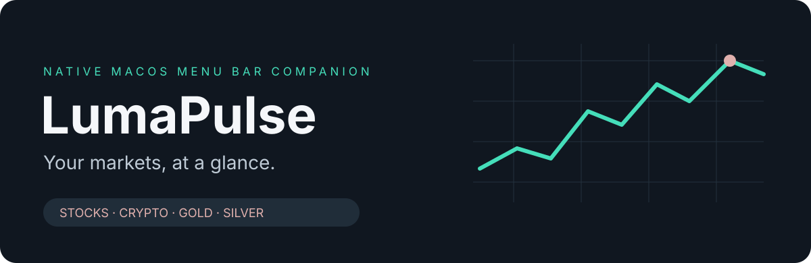

<p align="center"></p>

<p align="center">
<a href="https://github.com/AbdullahNazih/LumaPulse/actions/workflows/ci.yml"></a>


</p>

<p align="center"><a href="https://github.com/AbdullahNazih/LumaPulse/releases"><strong>Download LumaPulse</strong></a> · <a href="docs/USER-GUIDE.md">User guide</a> · <a href="PRIVACY.md">Privacy</a> · <a href="SECURITY.md">Security</a></p>

LumaPulse is a native macOS menu bar companion for **stocks, crypto, gold, silver, and macro news**. Scan your briefing, save a story, or let a timed market alert bring a new development into view.

> **Release candidate:** the current preview is ad-hoc signed and not notarized. A Developer ID–signed stable release is pending signing credentials. Authenticated streaming requires your own provider subscription and remains to be verified with real accounts. See the release notes before installing.

## A calmer way to follow markets

- **Your asset classes:** Stocks, Crypto, Gold, Silver, Macro, and optional World coverage.
- **Live providers:** optional Benzinga news and Trading Economics economic-release streams, with credentials stored in macOS Keychain.
- **RSS fallback:** CNBC, CoinDesk, FXStreet, and the Federal Reserve; optional BBC World.
- **Readable alerts:** soft rose styling, automatic display, countdown, dismiss control, and saved 5-second, 10-second, 30-second, or custom durations up to 30 minutes.
- **Quick reading:** search, publisher attribution, forecast/analysis labels, market-driver filters, and bookmarks.
- **Future updates:** automatic GitHub version checks notify you of stable releases. Downloads and installation stay under your control.

## Get started

1. Download the app ZIP from [Releases](https://github.com/AbdullahNazih/LumaPulse/releases), extract it, and move LumaPulse.app into Applications.
2. Open the app, then click LumaPulse in the menu bar and use the sliders control for Preferences.
3. Enable live headlines and select RSS sources, or connect your subscribed streaming providers.
4. Choose your alert duration. Use **Test alert** for a clearly labeled fictional preview.

Requires **macOS 13 or later**. Release packages support Apple Silicon and Intel. Gatekeeper may block downloaded, non-notarized previews; the app does not disable system security protections. You can build from the source or wait for a notarized stable release.

RSS refreshes every 60 seconds; publisher delays may apply. Streaming access depends on your provider plan. Market-driver tags identify topics, not expected price impact or trading instructions. A new alert replaces the current alert. API access is separate from the app.

## Privacy and security

No analytics SDK, advertising, developer account service, or developer-operated backend. Local preferences and bookmark IDs stay in the app sandbox. API keys use macOS Keychain. Enabled publishers and GitHub receive ordinary connection metadata. Read the [privacy notice](PRIVACY.md).

The app uses **App Sandbox**, outbound network access only, hardened runtime, bounded network responses, domain-restricted article links, protected XML parsing, and notification-only updates. CI checks source secrets, functional/adversarial cases, workflow pins, and packaged protections. See the [security policy](SECURITY.md) for the controls, release assurance, and verification limits.

## Build and maintain

No third-party runtime dependencies. Install Apple's command-line tools, then run:

```sh
zsh scripts/test.sh
zsh scripts/build.sh
open dist/LumaPulse.app
```

Use `LUMAPULSE_UNIVERSAL=1 zsh scripts/build.sh` for Apple Silicon + Intel. Local builds use an ad-hoc signature. Distribution builds fail unless a Developer ID identity is configured. The [release guide](docs/RELEASING.md) covers versioning, CI, signing, notarization, publication, update notifications, and aggregate download reports.

[Changelog](CHANGELOG.md) · [Provider setup](docs/PROVIDERS.md) · [Contributing](CONTRIBUTING.md) · [Report a bug](https://github.com/AbdullahNazih/LumaPulse/issues/new/choose)

Free for personal, non-commercial use under the [personal-use license](LICENSE.txt). Third-party data and API services remain subject to their providers' terms. © 2026 Abdullah Nazih.
